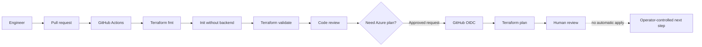

<div align="center">


### Infrastructure as Code · Secure CI · Human-approved change management

[](https://developer.hashicorp.com/terraform)
[](https://azure.microsoft.com/)
[](https://docs.github.com/actions)
[](https://learn.microsoft.com/azure/developer/github/connect-from-azure)

**A secure delivery workflow for Terraform-managed Azure infrastructure — from pull-request validation to an explicitly reviewed plan.**

[Architecture](#-delivery-architecture) · [Quick start](#-quick-start) · [Security](#-security-model) · [Runbooks & interview guide](docs/README.md)

</div>

> [!IMPORTANT]
> **Safety boundary:** the current workflow does not perform an automatic Terraform apply. The default validation path does not need Azure credentials. The optional Azure plan requires a separately configured GitHub environment and OIDC federation. No production deployment is claimed.

## The engineering problem

Infrastructure pipelines can turn a harmless code change into a costly or destructive cloud operation. This project demonstrates how to separate **untrusted code validation**, **cloud-authenticated planning**, and **human authorization**.

## Delivery architecture



## What this repository demonstrates

- Terraform configuration checks in GitHub Actions.
- Backend-free initialization for credential-free validation jobs.
- A separate optional OIDC-authenticated planning path.
- Explicit separation between pull-request validation and cloud permissions.
- A human review point before any infrastructure change is applied.

## Technology stack

| Layer | Technology | Purpose |
|---|---|---|
| Infrastructure | Terraform, AzureRM | Declare Azure resources |
| Source control | Git, GitHub | Version and review infrastructure changes |
| Automation | GitHub Actions | Repeatable quality gates |
| Identity | GitHub OIDC, Microsoft Entra ID | Short-lived federated identity |
| Governance | Protected environments, reviewer approval | Control cloud-authenticated operations |

## Quick start

### Prerequisites

- Terraform CLI compatible with the repository's version constraints.
- Git.
- Azure CLI only if you intend to run an authenticated plan.
- A non-production Azure subscription for any optional cloud operation.

### Validate locally

Run from the Terraform root module directory:

```bash
terraform fmt -check -recursive
terraform init -backend=false
terraform validate
```

Inspect the workflow definitions in `.github/workflows/` before relying on any CI behavior. Run `terraform plan` only after configuring the correct backend, identity, subscription and input values.

## GitHub Actions OIDC setup

The optional `plan` job uses the GitHub Actions environment named `azure-plan`. Configure the same environment in the repository settings before running an authenticated plan.

### Microsoft Entra federated credential

Create a federated identity credential on the intended Entra app registration with these values:

| Setting | Value |
|---|---|
| Issuer | `https://token.actions.githubusercontent.com` |
| GitHub organization | `haqueamir70-coder` |
| Organization ID | `253802285` |
| Repository | `azure-terraform-cicd` |
| Repository ID | `1331310763` |
| Entity type | `Environment` |
| Environment | `azure-plan` |
| Audience | `api://AzureADTokenExchange` |

The Entra portal's immutable-ID subject format should be generated from the organization, repository and environment fields. Do not manually substitute a different subject. The configured subject should correspond to this repository and the `azure-plan` environment.

### GitHub environment secrets

Add the following secrets to **Settings → Environments → azure-plan → Environment secrets**:

- `AZURE_CLIENT_ID`: the intended Entra application (client) ID.
- `AZURE_TENANT_ID`: the Entra tenant ID.
- `AZURE_SUBSCRIPTION_ID`: the target Azure subscription ID.

Do not create or use `AZURE_CLIENT_SECRET`; this workflow is designed for OIDC. Keep tenant and subscription identifiers in the private environment configuration rather than committing them to source.

### Run an authenticated plan

1. Confirm the Entra app has the federated credential for this exact repository and environment.
2. Confirm the three environment secrets above exist and the app has only the required Azure RBAC permissions.
3. Open **Actions → Azure Terraform CI → Run workflow**.
4. Select branch `main` and set `run_plan` to `true`.
5. Review the OIDC login and Terraform plan output. A successful validation-only run does not prove Azure authentication.
6. This workflow does not run `terraform apply`.

## Security model

- **No embedded credentials:** never put service-principal secrets in YAML, scripts or committed variable files.
- **Federated identity:** prefer OIDC over long-lived client secrets.
- **Least privilege:** scope the Azure role to the exact resources and operations needed.
- **Protected environment:** require reviewer approval for cloud-authenticated planning where appropriate.
- **State protection:** remote state must have restricted access, encryption, versioning and locking.
- **No automatic apply:** this repository intentionally keeps apply outside the default CI path.

> [!CAUTION]
> A historical workflow revision contained an exposed service-principal credential and an automatic apply step. The current workflow removes both patterns, but Git history may still contain the old credential. **Revoke and rotate that credential immediately if this has not already been done**, then review Azure sign-in and activity logs. Removing a secret from the latest file does not erase it from Git history.

## Repository navigation

| Path | Purpose |
|---|---|
| `.github/workflows/` | CI and optional OIDC plan workflows |
| `docs/README.md` | Architecture, interview questions and answers |
| `docs/ZERO-TO-HERO.md` | End-to-end learning guide |
| `docs/ADVANCED-INTERVIEW-BANK.md` | Advanced scenario-based Q&A |

## Operational checklist

- [ ] Review Terraform provider and action versions.
- [ ] Configure backend and state access separately from validation.
- [ ] Configure GitHub OIDC trust for the exact repository/environment.
- [ ] Restrict the Azure role to required actions.
- [ ] Review the complete plan and estimated cost.
- [ ] Obtain approval before any apply.
- [ ] Record the change and rollback procedure.

## Verified Azure OIDC evidence

The manually dispatched [Azure Terraform CI #31](../../actions/runs/42474695790) completed all three jobs successfully on 8 November 2026. The authenticated plan job's logs confirm the GitHub OIDC subject, successful Azure CLI login, successful subscription selection and a Terraform plan result of **1 to add, 0 to change, 0 to destroy**.

This run used `terraform init -backend=false`; it is an authenticated backend-free demonstration plan, not a remote-state drift assessment or deployment. No `terraform apply` was executed. See [OIDC verification evidence](docs/OIDC-VERIFICATION.md) for the exact scope, run reference and remaining controls.

## Validation evidence

A successful `fmt`, `init` or `validate` step proves configuration checks completed; it does **not** prove Azure resources were deployed. Check the repository's [Actions history](../../actions) for current workflow evidence.

## Further reading

- [Microsoft: Connect GitHub Actions to Azure using OIDC](https://learn.microsoft.com/azure/developer/github/connect-from-azure)
- [Terraform CLI documentation](https://developer.hashicorp.com/terraform/cli)
- [GitHub Actions security hardening](https://docs.github.com/actions/security-for-github-actions/security-guides/security-hardening-for-github-actions)

## Maintainer

**MD Amirul Haque** · [GitHub](https://github.com/haqueamir70-coder) · [LinkedIn](https://www.linkedin.com/in/md-amirul-haque/)

<sub>Build safely. Review every plan. Keep cloud identity short-lived.</sub>
