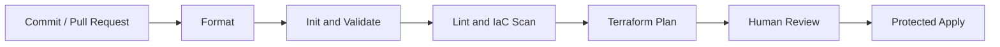

<div align="center">


[](https://developer.hashicorp.com/terraform)
[](https://azure.microsoft.com/)
[](https://github.com/haqueamir70-coder)

</div>

> **Portfolio project:** implementation status and limitations are documented below. The diagram describes the intended workflow/architecture and is not proof of a successful production deployment.

## 🗺️ Architecture at a Glance



---

# Azure Terraform CI/CD

This repository demonstrates a version-controlled workflow for Terraform-based Azure infrastructure. It is a learning/portfolio project; inspect the workflow files on the default branch to verify which stages are currently implemented and enabled.

## Goals

- Keep infrastructure configuration in Git.
- Run Terraform formatting and validation checks consistently.
- Review planned infrastructure changes before applying them.
- Introduce security scanning into the infrastructure delivery lifecycle.
- Use a secure Azure authentication approach for automation.

## Typical workflow

```text
Pull request / push
        |
        v
Checkout repository
        |
        v
Terraform init
        |
        v
Format check + validate
        |
        v
Infrastructure security scan
        |
        v
Terraform plan (review)
        |
        v
Approved apply (protected environment)
```

The diagram describes the intended workflow. Check `.github/workflows/` to confirm the actual configured steps and triggers.

## Technology stack

- Terraform
- Microsoft Azure / AzureRM provider
- Git and GitHub
- GitHub Actions
- YAML

## Recommended quality gates

1. `terraform fmt -check -recursive`
2. `terraform init -backend=false` for validation jobs that do not require a backend
3. `terraform validate`
4. A maintained infrastructure-as-code scanner, such as Trivy or Checkov
5. A plan step that uses a protected identity and does not expose secrets in logs
6. Apply only from a protected branch/environment with approval where appropriate

Adapt the commands to the repository layout and backend configuration; do not run a production apply automatically on every push.

## Security guidance

- Prefer Azure workload identity federation (OIDC) for GitHub Actions rather than long-lived client secrets.
- Grant the pipeline only the permissions it needs.
- Keep state in a secured remote backend with locking and restricted access.
- Never commit credentials, state files, plan files containing sensitive values, or real variable files.
- Pin and regularly review third-party GitHub Actions.
- Separate pull-request validation from deployment permissions.

## Run locally

With Terraform installed and Azure authentication configured:

```bash
terraform init
terraform fmt -check -recursive
terraform validate
terraform plan
```

Run commands from the directory containing the Terraform root module. Review the plan before any apply.

## Next improvements

- Add explicit workflow status badges after CI runs are verified.
- Add a pull-request validation workflow.
- Add Terraform security scanning and publish readable findings.
- Configure OIDC-based Azure login and least-privilege roles.
- Add protected environments and approval gates for apply.
- Document backend setup, prerequisites, and cleanup.

## Author

MD Amirul Haque · [GitHub profile](https://github.com/haqueamir70-coder) · [LinkedIn](https://www.linkedin.com/in/md-amirul-haque/)
