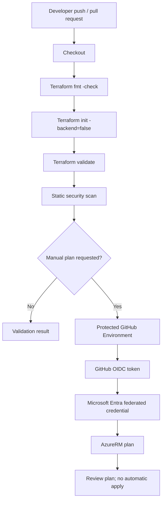

# Azure Terraform CI/CD with OIDC and gated plans — Architecture & Interview Guide

The pipeline validates Terraform on pull requests and supports an optional protected, OIDC-authenticated plan. Apply is deliberately not automatic. Rotate any credential previously exposed in Git history.

## Architecture diagram

## Interview questions

1. 1. Explain the end-to-end Terraform CI workflow in this repository.
2. 2. Why is terraform init -backend=false appropriate for credential-free validation?
3. 3. How does GitHub Actions OIDC authenticate to Azure?
4. 4. What trust conditions should be configured on the federated credential?
5. 5. Why should production plans use a protected GitHub Environment?
6. 6. Why is automatic terraform apply -auto-approve dangerous?
7. 7. How would you handle remote state and state locking in production?
8. 8. How do you prevent secrets from appearing in logs or Git history?
9. 9. What steps are required after a service-principal secret is exposed?
10. 10. How would you add policy checks and approval gates before apply?

## Interview preparation note
Be ready to explain the design decision, security boundary, failure mode, operational signal and validation evidence for each answer. Clearly separate implemented code, CI-validated configuration, cloud-deployed resources and future roadmap items.
